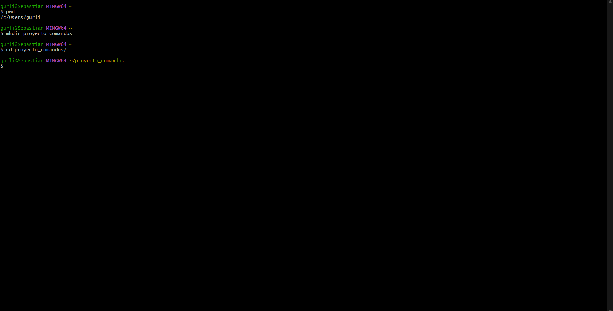
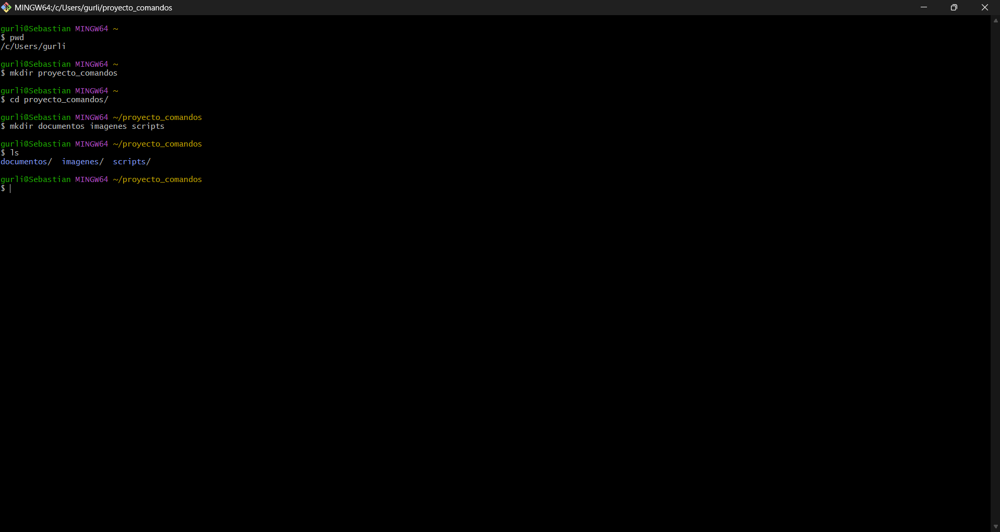
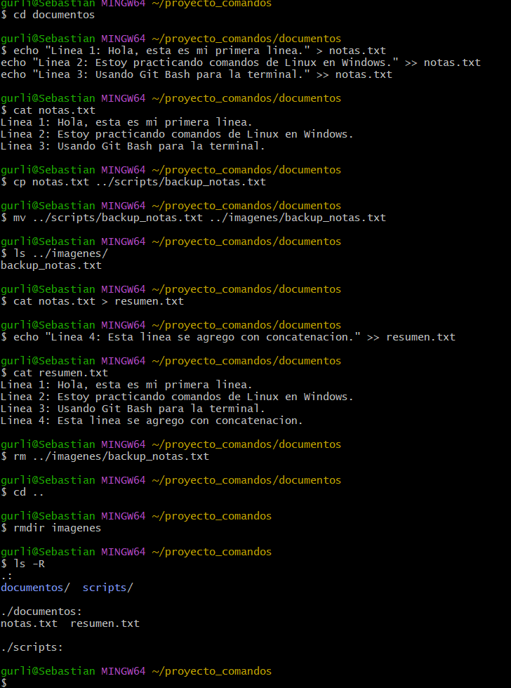
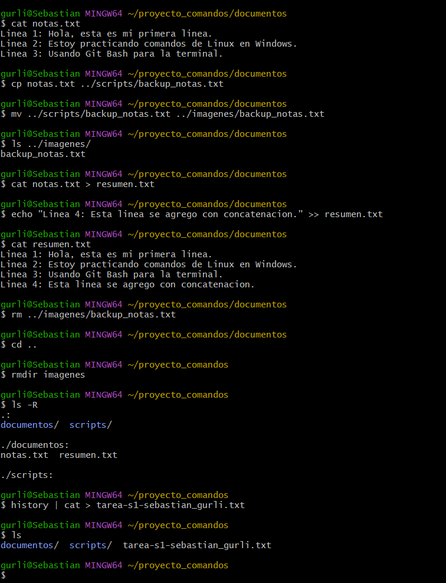

# Informe de Práctica: Comandos de Linux

## 1. Título
**Práctica No. 1: Creación, manipulación y gestión de archivos y directorios en Linux usando Git Bash en Windows**

## 2. Tiempo de duración
45 minutos.

## 3. Fundamentos

Linux es un sistema operativo de código abierto basado en Unix, ampliamente utilizado en servidores, desarrollo de software y entornos de producción. Su principal característica es el uso de una interfaz de línea de comandos (CLI) que permite interactuar con el sistema de forma rápida y eficiente, sin depender de una interfaz gráfica.

El sistema de archivos en Linux se organiza de forma jerárquica, partiendo desde el directorio raíz `/`. Cada carpeta y archivo tiene una ruta específica que puede ser absoluta (desde la raíz) o relativa (desde la ubicación actual). Comandos como `mkdir`, `cd`, `ls` y `pwd` permiten navegar y crear esta estructura.

La manipulación de archivos se realiza mediante comandos como `echo` (para escribir texto), `cat` (para visualizar contenido), `cp` (copiar), `mv` (mover o renombrar) y `rm` (eliminar). Un concepto clave es la **redirección**: el operador `>` sobrescribe el contenido de un archivo, mientras que `>>` agrega texto al final sin borrar lo existente.

Las **tuberías** (`|`) permiten conectar la salida de un comando como entrada de otro, facilitando tareas complejas. Por ejemplo, `history | cat > archivo.txt` guarda el historial de comandos en un archivo.

En Windows, herramientas como **Git Bash** emulan un entorno Linux, permitiendo ejecutar estos comandos sin necesidad de instalar un sistema operativo completo.



*Figura 1-1. Estructura jerárquica del sistema de archivos en Linux.*



*Figura 1-2. Diagrama de redirección y tuberías en Linux.*

## 4. Conocimientos previos

Para realizar esta práctica el estudiante necesita tener claro los siguientes temas:

- Comandos básicos de Linux (`mkdir`, `cd`, `ls`, `cp`, `mv`, `rm`, `rmdir`, `cat`, `echo`).
- Uso de Git Bash en Windows o terminal en Linux/Mac.
- Conceptos de redirección (`>`, `>>`) y tuberías (`|`).
- Manejo básico de navegador web.
- Uso de GitHub para subir archivos.

## 5. Objetivos a alcanzar

- Crear una estructura de carpetas desde la terminal.
- Crear y manipular archivos de texto usando `echo` y redirección.
- Copiar, mover y renombrar archivos entre directorios.
- Aplicar redirección (`>`) y concatenación (`>>`) de contenido.
- Eliminar archivos y carpetas vacías.
- Exportar el historial de comandos usando tuberías.

## 6. Equipo necesario

- Computador con sistema operativo Windows 10/11.
- Git Bash instalado (versión 2.x o superior).
- Conexión a internet.
- Cuenta en GitHub.

## 7. Material de apoyo

- Guía de la asignatura.
- Documentación de Git Bash.
- Documentación de GitHub.

## 8. Procedimiento

**Paso 1: Crear la estructura de carpetas**

```bash
mkdir proyecto_comandos
cd proyecto_comandos
mkdir documentos imagenes scripts
ls
```


*Figura 1-3. Captura del paso 1: creación de carpetas con mkdir.*

**Paso 2: Crear archivo de texto con contenido**

```bash
cd documentos
echo "Linea 1: Hola, esta es mi primera linea." > notas.txt
echo "Linea 2: Estoy practicando comandos de Linux en Windows." >> notas.txt
echo "Linea 3: Usando Git Bash para la terminal." >> notas.txt
cat notas.txt
```


*Figura 1-4. Captura del paso 2: creación y visualización de notas.txt.*

**Paso 3: Copiar y mover archivos**

```bash
cp notas.txt ../scripts/backup_notas.txt
mv ../scripts/backup_notas.txt ../imagenes/backup_notas.txt
ls ../imagenes/
```

**Paso 4: Redirección y concatenación**

```bash
cat notas.txt > resumen.txt
echo "Linea 4: Esta linea se agrego con concatenacion." >> resumen.txt
cat resumen.txt
```

**Paso 5: Eliminar archivos y carpetas**

```bash
rm ../imagenes/backup_notas.txt
cd ..
rmdir imagenes
ls -R
```



*Figura 1-5. Captura del paso 5: resultado final con ls -R mostrando la estructura.*

**Paso 6: Exportar historial con tuberías**

```bash
history | cat > tarea-s1-sebastian_gurli.txt
ls
```



*Figura 1-6. Captura del paso 6: comando history exportado con tuberías.*

## 9. Resultados esperados

Al finalizar la práctica, se obtiene una estructura de directorios limpia y funcional. La carpeta `imagenes` fue eliminada exitosamente al estar vacía, cumpliendo con la restricción del comando `rmdir`. Los archivos `notas.txt` y `resumen.txt` permanecen en la carpeta `documentos` con el contenido adecuado, demostrando el correcto uso de los operadores de redirección. Finalmente, se genera el archivo `tarea-s1-sebastian_gurli.txt` con el registro de todos los comandos ejecutados durante la sesión.

Estructura final obtenida:

```
proyecto_comandos/
├── documentos/
│   ├── notas.txt
│   └── resumen.txt
├── scripts/
│   └── (vacía)
└── tarea-s1-sebastian_gurli.txt
```


*Figura 1-7. Captura de pantalla del resultado final de la práctica.*

## 10. Bibliografía

- DigitalOcean. (s.f.). *Linux commands*. Recuperado de https://www.digitalocean.com/community/tutorials/linux-commands
- The Linux Kernel Organization. (s.f.). *The Linux Kernel documentation*. Recuperado de https://docs.kernel.org/
- Ubuntu. (s.f.). *Command line for beginners*. Recuperado de https://ubuntu.com/tutorials/command-line-for-beginners#1-overview
```


